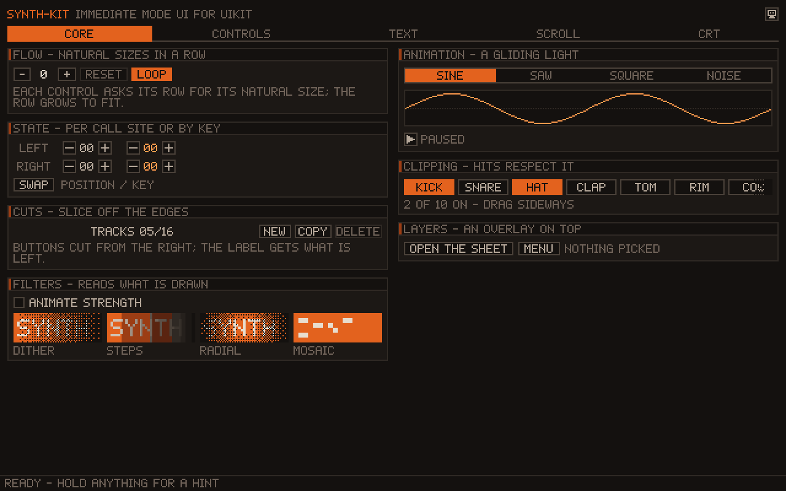
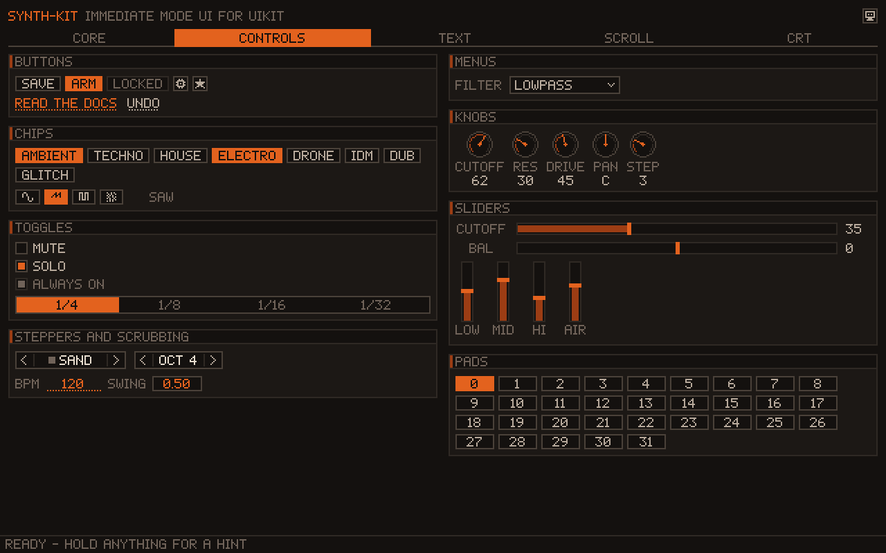
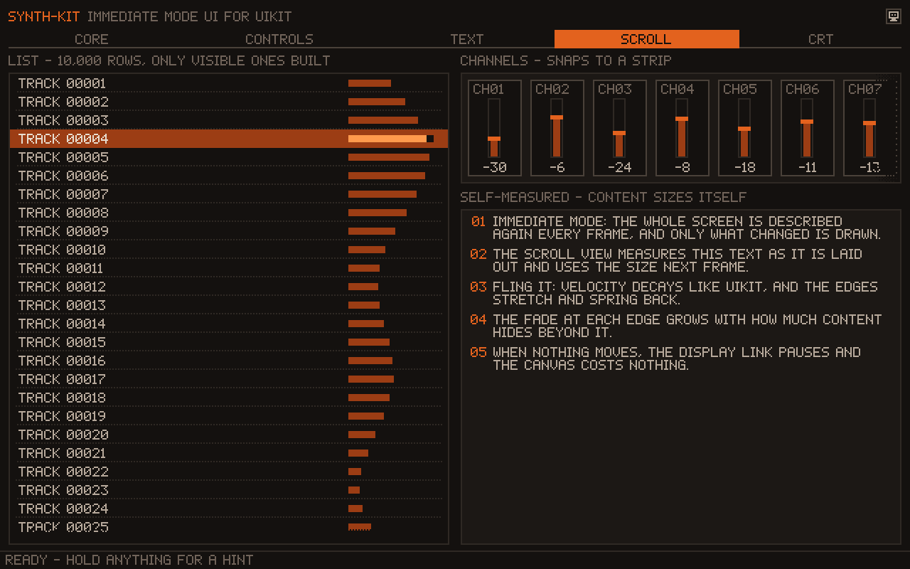

# SynthezKit

An immediate-mode, pixel-art UI framework for UIKit.

You describe the whole screen in plain Swift every frame. SynthezKit lays it out on a grid of virtual pixels, rasterizes it into a 256-color indexed framebuffer on the CPU, and puts it on screen through Metal, optionally through a physically modeled CRT. When nothing moves, the display link pauses and the view costs nothing.

```swift
import SynthezKit
import SynthezWidgets

let canvas = SZCanvasView(palette: SZTheme.synthPalette(), background: 1, resolution: .pixelScale(3))
var count = 0
canvas.body = { ctx in
    ctx.inset(8)
    ctx.row(height: 11, gap: 3, align: .center) { row in
        if button(&row, "-").clicked { count -= 1 }
        label(&row, String(count))
        if button(&row, "+").clicked { count += 1 }
    }
}
```

## Features

- **Immediate mode.** Widgets are functions that return what happened this frame (`clicked`, a new value, a picked item). No retained view tree, no callbacks, no bindings.
- **Stable identity without strings.** State, animations and hit targets are keyed by 64-bit hashes derived from call position, or from an explicit key where order can change. State that stops being drawn is released.
- **Pixel-exact layout.** A cursor-and-cut layout on whole virtual pixels: rows, columns, natural sizes, RectCut-style slicing, clipping and overlay layers.
- **Palette rendering.** Everything is a palette index. Fades, shadows and dimming map colors to their nearest palette neighbors in OKLab instead of blending, and dissolve with ordered Bayer dithering.
- **Only draws what changed.** Each frame's draw list is compared with the last one; an identical frame skips rasterizing and uploading. An idle canvas pauses its [DisplayLink](https://github.com/Lakr233/DisplayLink) and uses no CPU.
- **Touch-first input.** Taps, drags with capture, flings with UIKit-like deceleration, rubber-banding and snapping, trackpad scrolling and hover, and input trickling so a gesture that lands within one frame is never lost.
- **CRT post-process.** Phosphor afterglow, halation, brightness-dependent scanline beams, aperture, slot and shadow masks, and vignette, all in linear light.
- **Keyboard and accessibility.** Text fields drive the system keyboard, and every interactive widget is a VoiceOver element that can be activated and adjusted, which also makes the UI scriptable from UI tests.

## Widgets

| Group | Widgets |
| --- | --- |
| Text | `label`, `paragraph`, `textField` |
| Buttons | `button`, `iconButton`, `textButton`, `checkbox` |
| Choices | `segmented`, `chipGroup`, `tabs`, `dropdown`, `menu` |
| Values | `slider`, `knob`, `stepper`, `scrubValue` |
| Containers | `card`, `scrollView`, `list` (virtual, 10,000 rows cost one screenful), `sheet` |
| Feedback | `statusLine`, `tooltip` |
| Drawing | `fill` with dither patterns, `stroke`, `line`, `circle`, `bitmap`, `text`, `remap`, `mosaic`, `filter` (dither or steps, over constant, linear and radial strength fields) |

| Controls | Scrolling |
| --- | --- |
|  |  |

## Requirements

- iOS 15, Mac Catalyst 15 (`SynthezKit`)
- macOS 12 for the platform-independent `SynthezCore`, `SynthezWidgets` and the benchmark
- Swift 6.2 tools, Swift 6 language mode

## Installation

Add the package with Swift Package Manager:

```swift
.package(url: "https://github.com/Lakr233/SynthezKit.git", branch: "main"),
```

Then depend on the products you need:

| Product | Contents |
| --- | --- |
| `SynthezCore` | Layout, identity, input routing, draw list, CPU rasterizer, palette, scheduler. Foundation only. |
| `SynthezWidgets` | Theme, 5×7 pixel font, icons and all widgets. |
| `SynthezKit` | `SZCanvasView`: Metal presentation, display link, touch, keyboard, accessibility and CRT. |
| `SynthezGallery` | The demo pages, shared by the example app, tests and benchmark. |

## How a frame works

1. A touch or a running animation wakes the display link.
2. `SZUI.frame` routes input against the previous frame's hit rectangles, then runs your body. Widgets register hit rectangles, read and write their state, and append draw commands to a list bucketed by layer.
3. If the draw list equals the previous one, nothing else happens. Otherwise `SZSurface` replays it into a one-byte-per-pixel framebuffer.
4. `SZMetalPresenter` uploads the framebuffer into one of three rotating `r8Uint` textures and resolves palette colors on the GPU, with sharp-bilinear scaling or the CRT pipeline.
5. When no animation, input or afterglow is pending, the display link pauses.

See [Documents/Design.md](./Documents/Design.md) for the architecture and the reasoning behind it, and [Documents/Benchmarks.md](./Documents/Benchmarks.md) for measurements.

## Example app

`Example/SynthezKitExample.xcodeproj` runs the gallery: five pages (Core, Controls, Text, Scroll, CRT) that exercise every widget. It references this package locally.

## Development

```sh
swift test                                   # layout, routing, raster, widgets, gallery pages
swift run -c release SynthezBench            # per-page frame timings
swift run -c release SynthezBench --snapshot <dir>   # render every page to PNG
```

## Acknowledgements

- [synth-ui](https://github.com/unixzii/synth-ui) by Cyandev (MIT) is the model for this project: the immediate-mode API, position-derived keys, previous-frame hit routing, cursor-and-cut layout, the palette, color-map and dither approach, and the CRT pipeline design all follow its lead. SynthezKit is an independent Swift reimplementation for UIKit and is not affiliated with synth-ui or its authors.
- [DisplayLink](https://github.com/Lakr233/DisplayLink) (MIT) drives frames and pauses them when idle.
- [Litext](https://github.com/Lakr233/Litext) (MIT) informed the frame-time animation model, measurement caching and the habit of measuring before optimizing.
- [Dear ImGui](https://github.com/ocornut/imgui) for input queue trickling, and Martin Cohen's RectCut for the slicing layout.
- [OKLab](https://bottosson.github.io/posts/oklab/) by Björn Ottosson for perceptual nearest-color matching.

## License

MIT. See [LICENSE](./LICENSE).
